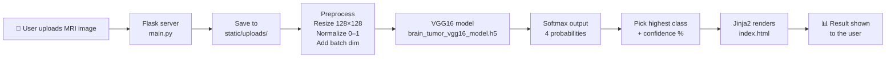

<div align="center">

# 🧠 NeuroScan AI — Brain Tumor Detection from MRI Scans

**An end-to-end Deep Learning + Computer Vision web application that classifies brain MRI scans into four diagnostic categories using a fine-tuned VGG16 CNN, served through a Flask web app.**


-8b6bff)


</div>

---

## 📑 Table of Contents

1. [Project Overview](#-project-overview)
2. [Key Features](#-key-features)
3. [Tech Stack](#-tech-stack)
4. [How the System Works (Architecture)](#-how-the-system-works-architecture)
5. [Project Structure](#-project-structure)
6. [Dataset](#-dataset)
7. [Model Development (Step by Step)](#-model-development-step-by-step)
8. [Model Evaluation & Results](#-model-evaluation--results)
9. [Web Application (Flask Backend)](#-web-application-flask-backend)
10. [Frontend (UI)](#-frontend-ui)
11. [Installation & Local Setup](#-installation--local-setup)
12. [Usage](#-usage)
13. [Deployment](#-deployment)
14. [Limitations & Honest Notes](#-limitations--honest-notes)
15. [Future Improvements](#-future-improvements)
16. [Disclaimer](#-medical-disclaimer)
    

---

## 📌 Project Overview

**NeuroScan AI** is a complete machine-learning project that goes from *raw MRI images* all the way to a *working web application* that anyone can use in a browser.

A user uploads a brain MRI image, and the system tells them which of the following four categories the scan most likely belongs to:

| Class | Meaning |
|---|---|
| **Glioma** | A tumor that grows from glial cells in the brain or spinal cord |
| **Meningioma** | A tumor that forms in the meninges (the membranes covering the brain and spinal cord) |
| **Pituitary** | A tumor in the pituitary gland at the base of the brain |
| **No Tumor** | Normal brain tissue with no tumor detected |

Along with the predicted class, the app shows a **confidence score** and a **probability breakdown across all four classes**, so the user can see not only *what* the model predicts but also *how sure* it is.

The project has two major parts:

1. **Model training** (Jupyter Notebook) — building and fine-tuning a VGG16 CNN with Transfer Learning in TensorFlow/Keras, then saving it as `brain_tumor_vgg16_model.h5`.
2. **Web application** (Flask + HTML/CSS/JS) — loading the saved model, preprocessing uploaded images, running inference, and displaying the results in a modern medical-style dashboard.

---

## ✨ Key Features

- 🔬 **4-class MRI classification** — Glioma, Meningioma, Pituitary, and No Tumor.
- 🧠 **Transfer Learning with VGG16** — leverages ImageNet-pretrained convolutional features instead of training from scratch.
- 📊 **Full probability output** — Softmax probabilities for every class, not just the top prediction.
- 🎯 **Confidence score** — the probability of the predicted class, shown as a percentage and a progress meter.
- 🟢🔴 **Color-coded diagnosis** — green for *No Tumor*, red for *Tumor Detected*.
- 🖼️ **Live image preview** — shows a thumbnail of the selected file before uploading, and the uploaded scan next to the result.
- 📥 **Drag-and-drop upload** — drop an image onto the upload zone or click to browse.
- ⏳ **Loading overlay** — "Analyzing MRI scan..." spinner while inference is running.
- 📱 **Responsive dark UI** — works on desktop and mobile screens.
- ☁️ **Deployment-ready** — `gunicorn` included for hosting on platforms like Render or PythonAnywhere.

---

## 🛠 Tech Stack

### Machine Learning / Data Science
| Tool | Purpose |
|---|---|
| **TensorFlow / Keras** | Building, training, saving and loading the deep learning model |
| **VGG16 (ImageNet weights)** | Pretrained CNN backbone used for transfer learning |
| **NumPy** | Image array handling and numerical operations |
| **Pillow (PIL)** | Image loading and image enhancement (`ImageEnhance`) for augmentation |
| **scikit-learn** | Data shuffling, evaluation metrics, confusion matrix, ROC/AUC |
| **Matplotlib & Seaborn** | Plotting training curves, confusion matrix and ROC curves |

### Backend
| Tool | Purpose |
|---|---|
| **Flask** | Lightweight Python web server and routing |
| **Jinja2** | Server-side HTML templating (comes with Flask) |
| **Gunicorn** | Production WSGI server for deployment |

### Frontend
| Tool | Purpose |
|---|---|
| **HTML5 + CSS3** | Page structure and a custom dark "medical dashboard" theme |
| **Vanilla JavaScript** | File preview, drag-and-drop, loading overlay |
| **Google Fonts (Inter)** | Typography |

### Development Environment
- **VS Code** + **Jupyter Notebook**
- **Git & GitHub** for version control

---

## 🏗 How the System Works (Architecture)



**In plain words:**

1. The user selects an MRI image in the browser and clicks **Run Diagnostic Scan**.
2. The image is sent to the Flask server through an HTTP `POST` request.
3. Flask saves the file into `static/uploads/`.
4. The image is **resized to 128×128**, **scaled to the 0–1 range**, and given an extra batch dimension so the model can accept it.
5. The pre-trained VGG16-based model runs inference and outputs **four probabilities** (Softmax) that add up to 100%.
6. The class with the highest probability becomes the prediction; its probability is the **confidence**.
7. Flask passes the result, confidence, all probabilities, badge color and image URL to the HTML template, which renders the final dashboard.

---

## 📂 Project Structure

```
NeuroScan-AI/
│
├── 01modeltraining.ipynb              # Jupyter notebook: model building & training
├── main.py                            # Flask application (backend + inference)
├── requirements.txt                   # Python dependencies
├── brain_tumor_vgg16_model.h5         # Trained model (see note on file size below)
│
├── templates/
│   └── index.html                     # Frontend UI (Jinja2 + HTML/CSS/JS)
│
├── static/
│   └── uploads/                       # Uploaded MRI images (auto-created at runtime)
│
├── images/                            # Result visuals used in this README
│   ├── MODEL_TRAINING.png
│   ├── CONFUSION_MATRIX.png
│   └── Multi_Class_ROC_Curves_n_AUC_Scores.png
│
└── README.md
```

> **Note:** Flask looks for HTML files inside a folder named `templates/`, so `index.html` must live there.
>
> **Note on the model file:** GitHub blocks files larger than 100 MB. If your `.h5` file is large, use [Git LFS](https://git-lfs.com/) or host the model on Google Drive / Hugging Face and link to it here.

---

## 🗃 Dataset

The model classifies MRI images into four folders/classes:

```
glioma  |  meningioma  |  notumor  |  pituitary
```

- **Task type:** Multi-class image classification (4 classes)
- **Input type:** Brain MRI images (color/RGB-loaded, resized to 128×128)
- **Test set:** From the confusion matrix, the test set is **perfectly balanced with 400 images per class (1,600 test images in total)**.

> ✏️ **Add your dataset details here:** name of the dataset, source link (e.g., Kaggle), total image count, and the train/validation/test split you used.

---

## 🧪 Model Development (Step by Step)

All model work is done in [`01modeltraining.ipynb`](01modeltraining.ipynb).

### Step 1 — Setting up the environment

Installed and imported the required libraries:

```python
!pip install tensorflow pillow numpy scikit-learn matplotlib seaborn flask
```

```python
import os                                           # directory and file operations
import numpy as np                                  # numerical operations, image arrays
import random                                       # random values for augmentation
from PIL import Image, ImageEnhance                 # image processing and enhancement

from tensorflow.keras.models import Sequential     # build the network layer by layer
from tensorflow.keras.layers import Input, Dense, Flatten, Dropout
from tensorflow.keras.preprocessing.image import load_img
from tensorflow.keras.optimizers import Adam
from tensorflow.keras.applications import VGG16     # pretrained backbone
from sklearn.utils import shuffle                   # shuffle the dataset
```

### Step 2 — Loading the data

- Image paths were collected class-by-class from the dataset directories using `os`.
- Each image was loaded with `load_img` and converted into a NumPy array.
- Labels were assigned based on the class folder name (glioma, meningioma, notumor, pituitary).

### Step 3 — Image preprocessing & augmentation

- **Resizing:** every image is resized to **128 × 128** pixels so all inputs have the same shape.
- **Normalization:** pixel values are divided by **255** to scale them from `0–255` to `0–1`, which helps training converge faster and more stably.
- **Augmentation:** random image enhancements using Pillow's `ImageEnhance` (together with Python's `random`) were applied to create slightly varied versions of the training images. This helps the model generalize and reduces overfitting.
- **Shuffling:** `sklearn.utils.shuffle` was used so that images from the same class are not grouped together during training.

### Step 4 — Building the model with Transfer Learning (VGG16)

Instead of training a CNN from zero (which needs huge amounts of data and compute), we use **VGG16**, a well-known CNN pre-trained on the ImageNet dataset (over a million images).

**Idea:**
- The **convolutional base** of VGG16 already knows how to detect edges, textures, shapes and patterns.
- We **reuse** that base as a feature extractor and **fine-tune** it for brain MRI images.
- We **replace the original classifier** with our own small classification head for 4 classes.

**Architecture overview:**

```
Input MRI image (128 × 128 × 3)
        │
        ▼
┌─────────────────────────────────┐
│  VGG16 convolutional base       │   ← pretrained on ImageNet, fine-tuned
│  (feature extraction)           │
└─────────────────────────────────┘
        │
        ▼
     Flatten             ← converts feature maps into a 1-D vector
        │
        ▼
Dense + Dropout layers   ← learn tumor-specific patterns; Dropout reduces overfitting
        │
        ▼
Dense (4 units, Softmax) ← outputs 4 class probabilities
```

> ✏️ **Optionally add:** exact number of Dense units, dropout rate, and how many VGG16 layers were frozen vs. unfrozen.

### Step 5 — Compiling & training

- **Optimizer:** Adam
- **Loss function:** categorical cross-entropy (standard choice for multi-class classification)
- **Metric:** accuracy
- **Epochs:** 5

> ✏️ **Optionally add:** learning rate, batch size, validation split.

### Step 6 — Saving the model

After training, the model was saved as:

```
brain_tumor_vgg16_model.h5
```

This single file contains the architecture and learned weights, and is loaded directly by the Flask app.

---

## 📈 Model Evaluation & Results

### 1. Training Performance


The training curve over 5 epochs shows:

- 🟢 **Green line (accuracy)** rises quickly from about **0.83** in epoch 1 to about **0.96–0.97** by epoch 5.
- 🔴 **Red line (loss)** drops from about **0.44** in epoch 1 to about **0.10** by epoch 5.

This means the model learned fast (thanks to transfer learning) and the training had mostly stabilized by epochs 4–5.

---

### 2. Confusion Matrix


The confusion matrix compares **actual classes (rows)** with **predicted classes (columns)** on the test set of 1,600 images (400 per class).

| Actual \ Predicted | glioma | meningioma | notumor | pituitary |
|---|:---:|:---:|:---:|:---:|
| **glioma** | **315** | 19 | 60 | 6 |
| **meningioma** | 37 | **327** | 29 | 7 |
| **notumor** | 0 | 1 | **399** | 0 |
| **pituitary** | 1 | 7 | 1 | **391** |

**Overall test accuracy:** (315 + 327 + 399 + 391) / 1600 = **1432 / 1600 = 89.5%**

#### Per-class metrics (calculated from the confusion matrix)

| Class | Precision | Recall | F1-score | Test images |
|---|:---:|:---:|:---:|:---:|
| Glioma | 89.2% | 78.8% | 0.84 | 400 |
| Meningioma | 92.4% | 81.8% | 0.87 | 400 |
| No Tumor | 81.6% | 99.8% | 0.90 | 400 |
| Pituitary | 96.8% | 97.8% | 0.97 | 400 |
| **Macro average** | **90.0%** | **89.5%** | **0.89** | **1600** |

#### What the confusion matrix tells us

- ✅ **Pituitary** and **No Tumor** are detected extremely well (97.8% and 99.8% recall).
- ⚠️ **Glioma** is the hardest class: 60 glioma scans were predicted as *No Tumor* and 19 as *Meningioma*.
- ⚠️ **Meningioma** is sometimes confused with *Glioma* (37) and *No Tumor* (29).
- The model is *very* sensitive to normal scans (almost no healthy scan is mislabeled), but it **sometimes misses tumors by calling them "No Tumor"** — this is the most important error type in a medical setting and the main area to improve.

---

### 3. ROC Curves & AUC Scores


ROC curves were plotted in a **one-vs-rest** manner (each class against all the others). The closer a curve is to the top-left corner, the better the model separates that class.

| Class | AUC |
|---|:---:|
| Glioma | **0.92** |
| Meningioma | **0.99** |
| No Tumor | **1.00** |
| Pituitary | **1.00** |

The dashed diagonal line is *random chance* (AUC = 0.5). All four curves are far above it, which confirms the model has strong class-separation ability. Glioma has the lowest AUC, consistent with the confusion matrix.

---

### 📊 Results at a Glance

| Metric | Value |
|---|:---:|
| Final training accuracy (approx.) | ~96–97% |
| Final training loss (approx.) | ~0.10 |
| **Test accuracy** | **89.5%** |
| Macro Precision | 90.0% |
| Macro Recall | 89.5% |
| Macro F1-score | 0.89 |
| AUC (Glioma / Meningioma / No Tumor / Pituitary) | 0.92 / 0.99 / 1.00 / 1.00 |

---

## 🌐 Web Application (Flask Backend)

The backend lives in [`main.py`](main.py).

### 1. App initialization & model loading

The model is loaded **once at startup** (not on every request), which keeps predictions fast:

```python
BASE_DIR = os.path.dirname(os.path.abspath(__file__))
MODEL_PATH = os.path.join(BASE_DIR, 'brain_tumor_vgg16_model.h5')
model = load_model(MODEL_PATH)

CLASS_NAMES = ['glioma', 'meningioma', 'notumor', 'pituitary']
```

> The order of `CLASS_NAMES` must match the class-index order used during training.

### 2. Upload handling

Uploaded files are stored in `static/uploads/` (created automatically if it doesn't exist), and a dedicated route serves them back so the result page can display the uploaded image:

```python
@app.route('/static/uploads/<filename>')
def serve_upload(filename):
    return send_from_directory(app.config['UPLOAD_FOLDER'], filename)
```

### 3. Image preprocessing + prediction

```python
def predict_tumor(image_path):
    img = load_img(image_path, target_size=(128, 128))   # resize to 128×128
    img_array = img_to_array(img) / 255.0                # normalize to 0–1
    img_batch = np.expand_dims(img_array, axis=0)        # shape (1, 128, 128, 3)

    predictions = model.predict(img_batch)[0]            # 4 softmax probabilities
    predicted_idx = np.argmax(predictions)               # most likely class
    predicted_class = CLASS_NAMES[predicted_idx]
    confidence = float(predictions[predicted_idx]) * 100
    ...
```

The function then:
- builds a dictionary of all class probabilities (as percentages, rounded to 2 decimals),
- creates the title — `NO TUMOR DETECTION` or `TUMOR DETECTION : <CLASS>`,
- picks the badge style — `bg-success` (green) or `bg-danger` (red).

### 4. Main route

The `/` route handles both `GET` (show the upload page) and `POST` (receive the image, run prediction, show results):

| Method | Behavior |
|---|---|
| `GET /` | Renders the empty upload page |
| `POST /` | Saves the image → runs `predict_tumor()` → renders the page with the results |

---

## 🎨 Frontend (UI)

The interface is in [`templates/index.html`](templates/index.html) — a single file containing HTML, CSS and JavaScript, rendered with **Jinja2**.

**Design highlights**

- Dark "medical dashboard" theme with a blue→purple gradient accent.
- **Upload card** with a dashed drag-and-drop zone.
- **Selected-file row** showing thumbnail, file name and size before submission.
- **Loading overlay** with a spinner during inference.
- **Results card** that appears only after a prediction (``), with:
  - the uploaded scan,
  - a color-coded diagnosis (green = No Tumor, red = Tumor Detected),
  - a confidence meter,
  - an animated probability bar for each of the 4 classes,
  - a medical disclaimer.

**How Jinja2 connects backend and frontend**

```html

  <span>{{ result }}</span>
  <span>{{ confidence }}%</span>
  
     ... {{ class_name }} : {{ prob }}% ...
  

```

<!--
📸 Tip: add a screenshot of the running app and uncomment the line below.

-->

---

## ⚙️ Installation & Local Setup

### Prerequisites
- Python 3.9+ (use a version supported by your TensorFlow install)
- `pip`
- Git

### Steps

```bash
# 1. Clone the repository
git clone https://github.com/<your-username>/NeuroScan-AI.git
cd NeuroScan-AI

# 2. (Recommended) Create a virtual environment
python -m venv venv
source venv/bin/activate        # Linux / macOS
venv\Scripts\activate           # Windows

# 3. Install dependencies
pip install -r requirements.txt

# 4. Make sure the trained model file is in the project root:
#    brain_tumor_vgg16_model.h5

# 5. Run the app
python main.py
```

Now open your browser at:

```
http://127.0.0.1:5000
```

### `requirements.txt`

```
Flask
tensorflow
numpy
Pillow
gunicorn
```

---

## 🚀 Usage

1. Open the app in your browser.
2. **Drag and drop** an MRI image onto the upload zone (or click to browse).
3. Check the thumbnail preview, then click **Run Diagnostic Scan**.
4. Wait a moment while the *"Analyzing MRI scan..."* overlay appears.
5. Read the result:
   - **Diagnosis** — e.g., `TUMOR DETECTION : GLIOMA` or `NO TUMOR DETECTION`
   - **Confidence** — how sure the model is about its top prediction
   - **Class Probabilities** — the model's probability for each of the 4 classes

---

## ☁️ Deployment

The project is structured for easy cloud hosting. `gunicorn` is already in `requirements.txt`.

**Production start command:**

```bash
gunicorn main:app
```

**Example: Render**
1. Push the project to GitHub.
2. Create a new **Web Service** on [Render](https://render.com) and connect the repo.
3. Build command: `pip install -r requirements.txt`
4. Start command: `gunicorn main:app`

**Example: PythonAnywhere**
1. Upload the project files.
2. Create a virtual environment and install `requirements.txt`.
3. Point the WSGI configuration to `main.app`.

> ⚠️ In production, set `debug=False` (or simply run through Gunicorn, which ignores the `app.run(debug=True)` block).

---

## ⚠️ Limitations & Honest Notes

- **Not a clinical tool.** This is an educational/portfolio project and must never be used for real medical decisions.
- **Gap between training and test accuracy.** Training accuracy is ~96–97% while test accuracy is 89.5%, which suggests some overfitting or a difference between train and test data.
- **Glioma recall is the weakest (78.8%)**, and some tumors are predicted as "No Tumor" — a serious error type in medicine.
- **Small input size (128×128)** is used for speed, but it discards fine detail that may matter for subtle tumors.
- **Only 5 training epochs** were used; more tuning could improve results.
- **No external validation.** The model has not been tested on scans from different hospitals/scanners, so real-world performance is likely lower.
- **Single 2D image classification only** — it does not use full 3D MRI volumes or multiple slices.
- **The model only knows 4 classes.** If a non-MRI image (or an MRI of a different disease) is uploaded, it will still output one of the 4 classes.

---

## 🔮 Future Improvements

- Train for more epochs with **early stopping** and a **learning-rate scheduler**.
- Try stronger architectures (**ResNet, EfficientNet, DenseNet**) and compare with VGG16.
- Use **larger input size** (e.g., 224×224) and stronger augmentation.
- Add **Grad-CAM heatmaps** to show *which region* of the MRI influenced the prediction (explainable AI).
- Add **class-weighting / focal loss** or threshold tuning to reduce missed tumors (improve glioma recall).
- Add **input validation** (file type/size checks, rejecting non-MRI images) and use `secure_filename` for uploads.
- Provide a **REST API** endpoint (JSON response) alongside the web UI.
- **Dockerize** the application.
- Add **unit tests** and CI via GitHub Actions.

---

## 🩺 Medical Disclaimer

> **This project is for educational and research purposes only.** NeuroScan AI is **not** a certified medical device and does **not** provide a medical diagnosis. Predictions may be wrong. Always consult a qualified doctor or radiologist for any medical decision.


---

<div align="center">

⭐ If you found this project helpful, consider giving it a star on GitHub! ⭐

*Built with Flask, TensorFlow and VGG16*

</div>
